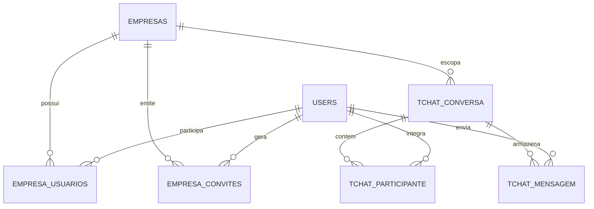

# 🏢 Tchat API — Plataforma Corporativa de Comunicação Multiempresa

[](https://www.php.net/)
[](https://codeigniter.com/)
[](https://www.postgresql.org/)
[-black?logo=jsonwebtokens)](https://jwt.io/)
[](#-arquitetura-e-multi-tenancy)

O **Tchat API** é um backend RESTful de alta performance projetado para suportar uma **plataforma corporativa de comunicação em equipe (WhatsApp Corporativo Multiempresa)**. 

Diferente de aplicativos de chat convencionais, o Tchat opera sob uma arquitetura **Multi-tenant**, na qual cada empresa cadastrada possui um ambiente privativo, seguro e personalizado com sua própria identidade visual (cores, logotipo, nome), além de gestão completa de colaboradores, permissões baseadas em funções (RBAC), sistema de convites e isolamento estrito de dados.

---

## 🎯 Destaques do Projeto

* **🏢 Multi-tenancy Corporativo Confiável**: Isolamento absoluto de dados entre organizações no nível da API. O tenant ativo é identificado pelo contexto da sessão e token autenticado — parâmetros enviados pelo cliente (`?empresa_id=X`) nunca são aceitos para autorização.
* **⚡ 100% SQL Puro com Prepared Statements**: Sem abstrações lentas ou Query Builders desnecessários. Todas as operações utilizam consultas SQL nativas altamente otimizadas para PostgreSQL (`RETURNING id`, `ON CONFLICT`, transações seguras e índices compostos).
* **🔒 Revogação de Acesso em Tempo Real**: Mitiga a principal vulnerabilidade de tokens JWT tradicionais (onde usuários demitidos continuam acessando o sistema até o token expirar). O filtro de autenticação valida a vigência do vínculo na empresa em tempo real no banco, bloqueando desligamentos instantaneamente.
* **🎨 Identidade Visual Dinâmica (White-label)**: Cada organização define seu logotipo, cor primária e cor secundária. O aplicativo mobile/web carrega essa paleta dinamicamente ao autenticar.
* **👥 Gestão Completa de Colaboradores e Convites**: Administradores convidam membros por e-mail ou telefone com tokens criptografados seguros (validade de 7 dias), alteram cargos e gerenciam status (ativo, inativo, suspenso).
* **🔔 Notificações Push & Anexos na Nuvem**: Suporte a envio de arquivos, imagens e áudios com armazenamento em bucket S3/Cloudflare R2 e notificações instantâneas via Expo Push API.

---

## 🏛️ Arquitetura e Multi-tenancy

O fluxo da plataforma segue o modelo corporativo hierárquico:

```
                    PLATAFORMA TCHAT
                           │
             ┌─────────────┴─────────────┐
             │                           │
    🏢 Empresa A (TechCorp)     🏢 Empresa B (InovaLog)
    ├── Identidade: Azul escuro ├── Identidade: Verde musgo
    ├── Colaboradores A         ├── Colaboradores B
    ├── Conversas A             ├── Conversas B
    └── Mensagens A             └── Mensagens B
```

### Modelo Relacional de Dados



### Por que uma Tabela Intermediária (`empresa_usuarios`)?

Ao invés de acoplar uma coluna `empresa_id` estática diretamente na tabela `users`, adotamos a tabela intermediária `empresa_usuarios`:

1. **Separação de Responsabilidades**: A tabela `users` guarda a **identidade do indivíduo** (nome, telefone, senha, avatar). A tabela `empresa_usuarios` guarda o **contexto corporativo** (cargo, empresa, status de admissão/desligamento).
2. **Suporte a Múltiplas Empresas**: Permite que diretores, consultores ou prestadores participem de mais de uma organização corporativa sem duplicar sua conta nem criar conflito com o número de telefone.
3. **Desligamento Seguro**: Desativar um colaborador de uma empresa altera seu vínculo naquele tenant para `status = 'inativo'`, sem corromper seus dados de acesso global.

---

## 🛠️ Tecnologias e Ferramentas

* **Linguagem**: PHP 8.2+ (PHP 8.4 compatível)
* **Framework**: CodeIgniter 4
* **Banco de Dados**: PostgreSQL 16
* **Autenticação**: JSON Web Tokens (`firebase/php-jwt`) com assinatura HS256
* **Storage**: Amazon S3 / Cloudflare R2 (Anexos e Fotos de Perfil)
* **Push Notifications**: Expo Push Notification Service
* **Padrões de Código**: Clean Code, Prepared Statements, RESTful APIs

---

## 📋 Especificação dos Endpoints RESTful

Todas as respostas são retornadas no formato `application/json`. Endpoints protegidos exigem o cabeçalho:
`Authorization: Bearer <SEU_TOKEN_JWT>`

### 1. Autenticação e Sessão

| Método | Endpoint | Acesso | Descrição |
| :--- | :--- | :--- | :--- |
| `POST` | `/api/register` | Público | Cadastro individual de usuário na plataforma. |
| `POST` | `/api/login` | Público | Autenticação do colaborador. Retorna o token JWT com a empresa ativa, identidade visual e lista de empresas disponíveis. |
| `GET` | `/api/me` | Autenticado | Retorna os dados do usuário, sua empresa ativa atual e seus outros vínculos. |
| `POST` | `/api/me/avatar` | Autenticado | Atualiza a foto de perfil do colaborador. |
| `POST` | `/api/empresa/trocar` | Autenticado | Alterna o ambiente corporativo ativo do usuário e emite um novo token JWT. |

### 2. Gestão de Empresas e Identidade Visual (Branding)

| Método | Endpoint | Acesso | Descrição |
| :--- | :--- | :--- | :--- |
| `POST` | `/api/empresas/registrar` | Público | Cadastra uma nova empresa e seu administrador inicial em uma única transação atômica. |
| `GET` | `/api/empresa` | Autenticado | Retorna dados e identidade visual da empresa (cores primária/secundária, logotipo, razão social). |
| `PUT` | `/api/empresa` | **Admin** | Atualiza cores da marca, logotipo e configurações gerais da empresa. |

### 3. Colaboradores e Contatos Corporativos

| Método | Endpoint | Acesso | Descrição |
| :--- | :--- | :--- | :--- |
| `GET` | `/api/empresa/colaboradores` | Autenticado | Lista todos os colaboradores ativos da mesma empresa para iniciar conversas. |
| `PATCH` | `/api/empresa/colaboradores/{id}/status` | **Admin** | Altera o status do colaborador (`ativo`, `inativo`, `suspenso`). |
| `PATCH` | `/api/empresa/colaboradores/{id}/cargo` | **Admin** | Promove ou altera o cargo (`admin`, `gerente`, `colaborador`). |

### 4. Sistema de Convites

| Método | Endpoint | Acesso | Descrição |
| :--- | :--- | :--- | :--- |
| `POST` | `/api/empresa/convites` | **Admin** | Gera um convite corporativo seguro com token único e validade de 7 dias. |
| `GET` | `/api/empresa/convites` | **Admin** | Lista todos os convites pendentes e histórico da empresa. |
| `DELETE` | `/api/empresa/convites/{id}` | **Admin** | Cancela um convite pendente. |
| `GET` | `/api/convites/{token}` | Público | Exibe os dados da empresa (nome, logo, cores) para quem recebeu o convite antes do aceite. |
| `POST` | `/api/convites/{token}/aceitar` | Público | Colaborador aceita o convite, cria/associa sua senha e ingressa imediatamente na empresa. |

### 5. Conversas e Mensagens

| Método | Endpoint | Acesso | Descrição |
| :--- | :--- | :--- | :--- |
| `GET` | `/api/conversas` | Autenticado | Lista as conversas ativas (1-a-1 e grupos) com última mensagem e contador de não lidas. |
| `POST` | `/api/conversas/privada` | Autenticado | Inicia ou recupera um chat 1-a-1 com outro colaborador da mesma empresa. |
| `POST` | `/api/conversas/grupo` | Autenticado | Cria um novo grupo corporativo com membros da mesma empresa. |
| `POST` | `/api/conversas/{id}/ler` | Autenticado | Marca a conversa como lida e zera o contador de mensagens não lidas. |
| `GET` | `/api/conversas/{id}/mensagens` | Autenticado | Histórico de mensagens com flags de tiques azuis (`enviado_por_mim`, `lida`) e paginação. |
| `POST` | `/api/mensagens` | Autenticado | Envia mensagens de texto, imagens, áudios ou documentos e dispara notificações push. |

### 6. Presença e Notificações Push

| Método | Endpoint | Acesso | Descrição |
| :--- | :--- | :--- | :--- |
| `POST` | `/api/presenca/ping` | Autenticado | Envia o batimento periódico (heartbeat) mantendo o colaborador como `online`. |
| `POST` | `/api/presenca/offline` | Autenticado | Marca o colaborador como `offline` ao minimizar ou fechar o aplicativo. |
| `GET` | `/api/presenca/{userId}` | Autenticado | Consulta o status em tempo real (`online` ou `offline`) de um colega de empresa. |
| `POST` | `/api/push/register` | Autenticado | Registra o token Expo Push (`ExponentPushToken[...]`) para entrega de notificações. |
| `POST` | `/api/push/webhook` | Público | Webhook de recibos de entrega para descarte automático de tokens desinstalados. |

---

## 💻 Instalação e Execução Local

### 1. Pré-requisitos
* PHP 8.2 ou superior (extensões `pdo_pgsql`, `intl`, `mbstring`, `curl` ativadas)
* PostgreSQL 14+
* Composer

### 2. Clonar o Projeto
```bash
git clone https://github.com/seu-usuario/tchat-api.git
cd tchat-api
```

### 3. Instalar Dependências
```bash
composer install
```

### 4. Configurar as Variáveis de Ambiente (`.env`)
Copie o arquivo de exemplo ou edite o seu `.env`:

```ini
CI_ENVIRONMENT = development

app.baseURL = 'http://localhost:8080/'

# Conexão com o PostgreSQL
database.default.hostname = localhost
database.default.database = tchat_app
database.default.username = postgres
database.default.password = sua_senha_aqui
database.default.DBDriver = Postgre
database.default.port = 5432

# Chave Secreta para Tokens JWT
JWT_SECRET_KEY = 'defina_uma_chave_criptografica_segura_aqui'
JWT_TIME_TO_LIVE = 604800 # 7 dias em segundos
```

### 5. Executar as Migrations e Seeds
O projeto conta com migrations automatizadas para criação de todas as tabelas e seeds completas com empresas e colaboradores de teste:

```bash
# Executa todas as migrations
php spark migrate

# Popula o banco com empresas, colaboradores e conversas simuladas
php spark db:seed DatabaseSeeder
```

### 6. Iniciar o Servidor
```bash
php spark serve
```
A API estará disponível e pronta para uso em `http://localhost:8080`.

---

## 🧪 Usuários de Teste (Criados pelo Seeder)

| Empresa | Colaborador | Telefone | Senha | Cargo |
| :--- | :--- | :--- | :--- | :--- |
| **TechCorp Soluções** | Ana Silva | `5511999990001` | `123456` | Administrador |
| **TechCorp Soluções** | Bruno Souza | `5511999990002` | `123456` | Colaborador |
| **TechCorp Soluções** | Carla Mendes | `5511999990003` | `123456` | Colaborador |
| **InovaLog Logística** | Diego Santos | `5511999990004` | `123456` | Administrador |
| **InovaLog Logística** | Elena Rocha | `5511999990005` | `123456` | Colaborador |

> **Dica de Teste Multi-tenant**: Faça login com a Ana (TechCorp) e tente iniciar uma conversa privada com o Diego (`destinatario_id: 4`, da InovaLog). A API retornará `403 Forbidden`, comprovando o bloqueio de acesso entre empresas diferentes.

---

## 🛡️ Decisões de Segurança e Performance

* **Prepared Statements em 100% das Consultas**: Nenhuma concatenação direta de variáveis é executada no SQL, neutralizando riscos de SQL Injection.
* **Validação RBAC em Dois Níveis**: Rotas administrativas são protegidas pelo `AdminFilter`, garantindo que colaboradores comuns nunca acessem rotas de configuração da empresa.
* **Integridade Referencial com Cascade**: As chaves estrangeiras entre empresas, vínculos, conversas e mensagens garantem coerência matemática em todas as deleções e atualizações.
* **Sequences Sincronizadas no PostgreSQL**: Todas as tabelas seriais utilizam chamadas `setval()` após inserções em batch, prevenindo colisões de chaves primárias.

---

## 👨‍💻 Autor

Projeto desenvolvido como solução de arquitetura de software e engenharia de backend para portfólio.
Fique à vontade para contribuir, abrir issues ou sugerir novas melhorias!
