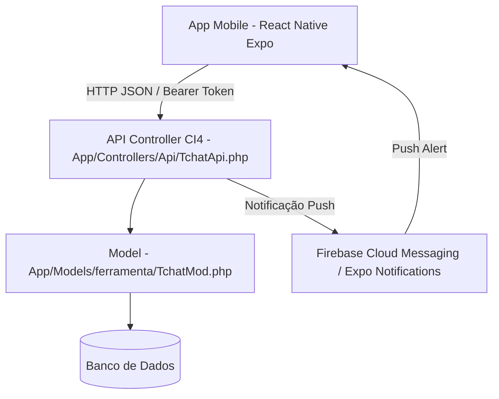

# 📱 Modelo de Especificação e Arquitetura: Sistema Tchat Mobile

Este documento contém o modelo completo para criação da versão aplicativo (Android/iOS) do **Tchat**, utilizando o backend existente em **CodeIgniter 4 (PHP 8)** e frontend móvel em **React Native (Expo)**.

---

## 📑 Sumário
1. [Visão Geral e Arquitetura](#1-visão-geral-e-arquitetura)
2. [Estrutura do Banco de Dados (DDL SQL)](#2-estrutura-do-banco-de-dados-ddl-sql)
3. [Especificação dos Endpoints da API REST (CodeIgniter 4)](#3-especificação-dos-endpoints-da-api-rest-codeigniter-4)
4. [Estrutura de Arquivos do Projeto Mobile (React Native + Expo)](#4-estrutura-de-arquivos-do-projeto-mobile-react-native--expo)
5. [Plano de Implementação em Fases](#5-plano-de-implementação-em-fases)

---

## 1. Visão Geral e Arquitetura

O sistema é dividido em duas camadas principais:

*   **Backend (Servidor CI4)**: Mantém as regras de negócio (`TchatMod.php`), banco de dados MySQL/PostgreSQL e envio de notificações push via VAPID/FCM (`TchatPush.php`). Expõe endpoints JSON para consumo mobile.
*   **Frontend Mobile (App Expo)**: Interface nativa desenvolvida em React Native, armazenando tokens com segurança (`expo-secure-store`) e exibindo conversas em tempo real.



---

## 2. Estrutura do Banco de Dados (DDL SQL)

Abaixo estão os scripts DDL de criação das tabelas principais utilizadas pelo Tchat.

```sql
-- 1. TABELA DE CONVERSAS (Salas / Grupos / Chats Diretos)
CREATE TABLE IF NOT EXISTS tchat_conversa (
    id SERIAL PRIMARY KEY,
    tipo VARCHAR(1) NOT NULL DEFAULT 'P', -- 'P': Privada (1 a 1), 'G': Grupo Privado, 'D': Departamento
    nome VARCHAR(150) NULL,
    chave_privada VARCHAR(100) UNIQUE NULL, -- Ex: '12:45' para garantir chat único entre 2 usuários
    id_grupo INT NULL, -- Vínculo com departamento ctr_grupo
    id_proprietario INT NULL,
    ultima_mensagem_id INT NULL,
    ultima_atividade_em TIMESTAMP DEFAULT CURRENT_TIMESTAMP,
    grupo_privado BOOLEAN DEFAULT FALSE,
    descricao TEXT NULL,
    regras TEXT NULL,
    imagem VARCHAR(255) NULL,
    encerrada_em TIMESTAMP NULL,
    encerrada_por INT NULL,
    excluida_em TIMESTAMP NULL,
    excluida_por INT NULL,
    exclusao_motivo TEXT NULL,
    criado_por INT NOT NULL,
    criado_em TIMESTAMP DEFAULT CURRENT_TIMESTAMP,
    atualizado_em TIMESTAMP DEFAULT CURRENT_TIMESTAMP,
    ativo BOOLEAN DEFAULT TRUE
);

-- 2. TABELA DE PARTICIPANTES (Vínculo Usuário x Conversa)
CREATE TABLE IF NOT EXISTS tchat_participante (
    id_conversa INT NOT NULL,
    id_usuario INT NOT NULL,
    mensagem_inicial_id INT DEFAULT 0, -- Filtro de histórico ao entrar
    ultima_mensagem_lida_id INT DEFAULT 0, -- Contador de não lidas e status de leitura
    entrou_em TIMESTAMP DEFAULT CURRENT_TIMESTAMP,
    saiu_em TIMESTAMP NULL,
    ativo BOOLEAN DEFAULT TRUE,
    administrador BOOLEAN DEFAULT FALSE,
    silenciado BOOLEAN DEFAULT FALSE,
    arquivado BOOLEAN DEFAULT FALSE,
    fixada BOOLEAN DEFAULT FALSE,
    vinculo_manual BOOLEAN DEFAULT FALSE,
    atualizado_em TIMESTAMP DEFAULT CURRENT_TIMESTAMP,
    PRIMARY KEY (id_conversa, id_usuario),
    FOREIGN KEY (id_conversa) REFERENCES tchat_conversa(id) ON DELETE CASCADE
);

-- 3. TABELA DE MENSAGENS
CREATE TABLE IF NOT EXISTS tchat_mensagem (
    id SERIAL PRIMARY KEY,
    id_conversa INT NOT NULL,
    id_usuario INT NOT NULL,
    tipo VARCHAR(20) DEFAULT 'texto', -- 'texto', 'imagem', 'arquivo', 'audio'
    mensagem TEXT NOT NULL,
    respondendo_id INT NULL, -- Suporte a resposta/reply
    client_id VARCHAR(80) NULL, -- ID gerado no app para evitar duplicidade
    encaminhada_de INT NULL,
    criado_em TIMESTAMP DEFAULT CURRENT_TIMESTAMP,
    editado_em TIMESTAMP NULL,
    excluido_em TIMESTAMP NULL,
    FOREIGN KEY (id_conversa) REFERENCES tchat_conversa(id) ON DELETE CASCADE,
    FOREIGN KEY (respondendo_id) REFERENCES tchat_mensagem(id) ON DELETE SET NULL
);

-- 4. TABELA DE ANEXOS (Mídias e Documentos)
CREATE TABLE IF NOT EXISTS tchat_anexo (
    id SERIAL PRIMARY KEY,
    id_mensagem INT NOT NULL,
    tipo VARCHAR(20) NOT NULL, -- 'imagem', 'pdf', 'audio', 'documento'
    nome_original VARCHAR(255) NOT NULL,
    caminho VARCHAR(255) NOT NULL,
    tamanho INT DEFAULT 0,
    criado_em TIMESTAMP DEFAULT CURRENT_TIMESTAMP,
    excluido_em TIMESTAMP NULL,
    FOREIGN KEY (id_mensagem) REFERENCES tchat_mensagem(id) ON DELETE CASCADE
);

-- 5. TABELA DE PRESENÇA (Status Online/Offline)
CREATE TABLE IF NOT EXISTS tchat_presenca (
    id_usuario INT PRIMARY KEY,
    status VARCHAR(20) DEFAULT 'offline', -- 'online', 'ausente', 'offline'
    ultima_atividade_em TIMESTAMP DEFAULT CURRENT_TIMESTAMP
);

-- 6. TABELA DE ASSINATURAS PUSH (Dispositivos Mobile / Web)
CREATE TABLE IF NOT EXISTS tchat_push_assinatura (
    id SERIAL PRIMARY KEY,
    id_usuario INT NOT NULL,
    device_token TEXT NOT NULL, -- Token do Expo / FCM
    plataforma VARCHAR(20) DEFAULT 'android', -- 'android', 'ios'
    criado_em TIMESTAMP DEFAULT CURRENT_TIMESTAMP,
    atualizado_em TIMESTAMP DEFAULT CURRENT_TIMESTAMP
);
```

---

## 3. Especificação dos Endpoints da API REST (CodeIgniter 4)

Todos os endpoints retornam `Content-Type: application/json`. As rotas protegidas exigem o cabeçalho `Authorization: Bearer <TOKEN>`.

### 3.1. Autenticação
*   `POST /api/auth/login`
    *   **Payload**: `{ "login": "usuario", "senha": "123" }`
    *   **Resposta (200 OK)**: `{ "status": "sucesso", "token": "jwt_ou_bearer_token", "usuario": { "id": 1, "nome": "João", "foto": "..." } }`

### 3.2. Conversas
*   `GET /api/tchat/conversas`
    *   **Resposta (200 OK)**: Retorna a lista de conversas ativas do usuário logado, incluindo última mensagem, hora e contador de não lidas.
*   `POST /api/tchat/conversa/privada`
    *   **Payload**: `{ "id_destino": 45 }`
    *   **Resposta (200 OK)**: Retorna o `id_conversa` existente ou recém-criado.

### 3.3. Mensagens
*   `GET /api/tchat/mensagens/{id_conversa}?antes_de=100&limite=40`
    *   **Resposta (200 OK)**: Histórico de mensagens da conversa (paginado).
*   `POST /api/tchat/mensagem`
    *   **Payload**: `{ "id_conversa": 12, "mensagem": "Olá!", "respondendo_id": 0, "client_id": "uuid-temp" }`
    *   **Resposta (200 OK)**: Objeto da mensagem salva com confirmação de envio.

### 3.4. Presença e Push
*   `POST /api/tchat/presenca/ping`
    *   Mantém a sessão do usuário como `'online'`.
*   `POST /api/tchat/push/registrar-token`
    *   **Payload**: `{ "token": "ExponentPushToken[xxx]", "plataforma": "android" }`

---

## 4. Estrutura de Arquivos do Projeto Mobile (React Native + Expo)

```
tchat-mobile/
├── assets/                  # Ícones, splash screen e imagens
├── src/
│   ├── api/
│   │   └── client.js        # Configuração do Axios com suporte a Interceptors e Token Bearer
│   ├── components/
│   │   ├── BalaoMensagem.jsx # Componente de balão verde/branco estilo WhatsApp
│   │   ├── ItemConversa.jsx # Card da conversa na lista principal
│   │   ├── CampoInput.jsx   # Input de texto + botão de enviar
│   │   └── HeaderChat.jsx   # Topbar com foto, nome e status online
│   ├── contexts/
│   │   ├── AuthContext.js   # Gerenciamento de login e token seguro
│   │   └── ChatContext.js   # Gerenciamento de mensagens e conversas ativas
│   ├── navigation/
│   │   ├── AppNavigator.jsx # Navegação por abas/telas (Stack Navigator)
│   ├── screens/
│   │   ├── LoginScreen.jsx     # Tela de login
│   │   ├── ConversasScreen.jsx # Tela principal (lista de chats)
│   │   └── ChatScreen.jsx      # Tela da sala de conversa ativa
│   ├── services/
│   │   └── pushService.js   # Registro e escuta de notificações push no Expo
│   └── styles/
│       └── theme.js         # Cores (verde WhatsApp, dark mode, fontes)
├── App.js                   # Ponto de entrada do React Native
├── app.json                 # Configuração do Expo
└── package.json             # Dependências do projeto
```

---

## 5. Plano de Implementação em Fases

### 🏁 Fase 1: API REST no CodeIgniter 4
1. Criar o Controller `app/Controllers/Api/TchatApi.php`.
2. Implementar rota de Login/Token em `app/Config/Routes.php`.
3. Criar os métodos que transformam o retorno do `TchatMod.php` em JSON.

### 📱 Fase 2: Aplicativo React Native (Expo) - MVP Visual
1. Criar o projeto: `npx create-expo-app tchat-mobile`.
2. Desenvolver as telas (`LoginScreen`, `ConversasScreen`, `ChatScreen`) utilizando **dados simulados (Mock Data)**.
3. Testar a navegabilidade e o design estilo WhatsApp no celular via **Expo Go**.

### 🔌 Fase 3: Conexão e Integração
1. Substituir o Mock Data por chamadas reais via `axios` para a API do CI4.
2. Armazenar o token de autenticação no `expo-secure-store`.

### 🔔 Fase 4: Notificações Push & Polling
1. Configurar `expo-notifications` no app mobile.
2. Conectar a chamada do `TchatPush.php` ao serviço de envio de push quando uma nova mensagem for registrada no banco.

---
*Documento gerado como especificação técnica para o projeto Tchat Mobile.*
